# Studio Manual

Studio is the Drift app. It shows what the `drift` command shows, with buttons instead of flags. This
manual walks through each screen in the order you meet it, with a picture of each. The pictures are
of the web build, taken in a desktop-sized window (1280 by 800 pixels) and, for the first two
screens, in a phone-sized one (390 by 844).

Studio only reads. It never changes your files and never sends anything anywhere. Every screen has a
one-paragraph explanation at the top, and a line that starts with "What to do next".

## Opening Studio

There are three ways in. They show the same screens.

- **In a browser.** Go to <https://drift.gmitch215.dev/atlas/>. Nothing to install. Add `#atlas` to
  the address to start on the Atlas tab.
- **From your machine, with `drift serve`.** `drift serve` is a small web server that is built into
  the `drift` command. It serves a Studio web build from a directory, on your own computer only. Build
  the directory once, then serve it:

  ```sh
  ./gradlew :cli:stageStudio
  drift serve --dir cli/build/serve/studio
  ```

  Open the address it prints, for example `http://localhost:8080/`. The [README](./README.md#studio-on-the-web)
  and the [usage guide](./ADVANCED_USAGE.md#serve) list the flags.
- **As a desktop app.** From a clone of the repository, `./gradlew :studio:run` starts Studio in a
  window. `drift open FILE.driftcase` opens a saved case in it.

The screenshots here are the web build. The desktop app was not photographed; its file choosers
are the operating system's own.

## Home

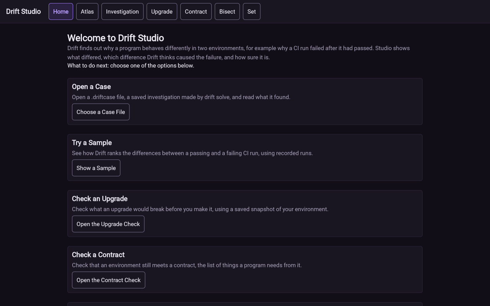

Home is the first screen. Each box is a way in, with one line on what it does and one button.
**Open a Case** reads a saved investigation from a file. **Try a Sample** uses recorded runs that
come with Studio. The next four boxes open Upgrade, Contract, Bisect and Set. **Browse the Atlas**
opens the Atlas.

If you have nothing to open yet, choose **Show a Sample**. It needs no file.

The row of buttons at the top (Home, Atlas, Investigation, Upgrade, Contract, Bisect, Set) stays on
every screen. A Case button joins the row once you open a case. On a phone the row wraps onto
several lines and the boxes stack in one column.

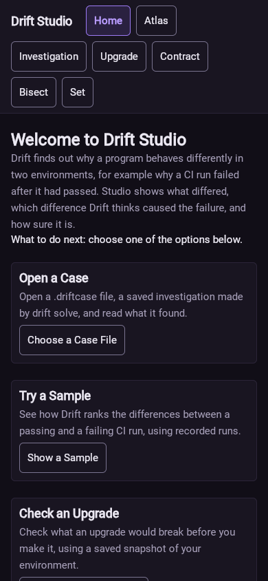

## Investigation

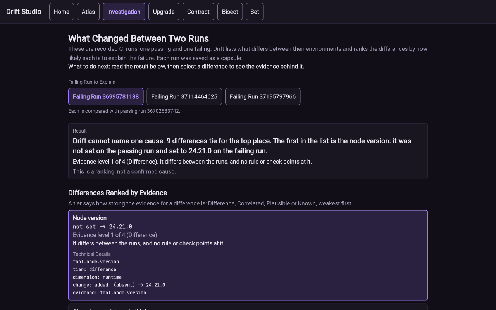

Choose **Show a Sample** on Home to open this screen. It is titled "What Changed Between Two Runs".
A capsule is a file that records one environment: the operating system, tool versions, environment
variables (secret values hidden) and the results of small checks. The sample holds capsules from
four real CI runs, which are automated test runs on a server. One run passed. The other three
failed, and each is compared with the passing one.

What to do:

1. Read the Result box. It states in one sentence what Drift found.
2. Pick another failing run with the **Failing Run** buttons if you want to compare a different one.
3. Select a difference in the list. Its box opens to show the setting's name and the evidence.
4. Choose **Show 6 More Differences** to see the rest, and **Show Technical Details** to see how
   Drift narrowed the list down.

The sample result reads "Drift cannot name one cause: 9 differences tie for the top place". That
means nine settings changed between the two runs, the data cannot tell them apart, and Drift
declines to pick one. The list is ordered by evidence level, from level 1 (Difference: it differs, and
no rule or check points at it) up to level 4 (Known). The screen says "This is a ranking, not a
confirmed cause."

## Atlas

The Atlas is a table of what small Kotlin programs print on each target. A target is a platform
that Kotlin builds for, such as the JVM, native code or WebAssembly. A probe is one of those small
programs. Each row is a probe, and each column is a target. The Atlas screen is titled "Kotlin
Across Targets".

### Device Column

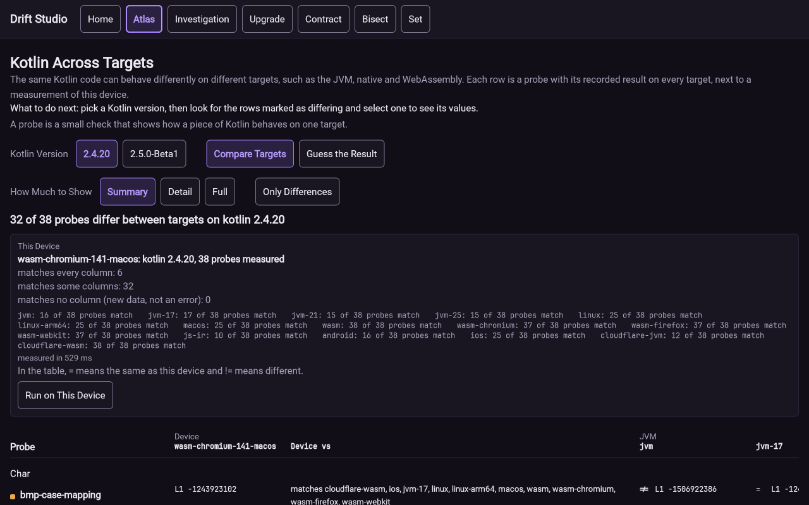

Studio runs every probe on your own device when it opens, and adds the result as the first
column, **Device**. The **This Device** panel above the table summarizes it. In the picture, 6
probes match every column, 32 match some columns and 0 match no column. Under that, a line
per target counts how many of the 38 probes behave like it, for example "wasm-chromium: 37 of 38
probes match".

The Device vs column in the table lists which targets print the same text as your device for that
probe. A `=` in a target cell means the same as this device, and `!=` means different.

What to do:

1. Pick a Kotlin version with the **Kotlin Version** buttons.
2. Choose **Run on This Device** to measure again. The panel shows how long the run took.
3. Choose **Only Differences** to hide the probes that print the same on every target.
4. Select a probe name to see its source and the values on each target.
5. Choose **Save Device Transcript** or **Show Device Transcript** to get the raw measurement.

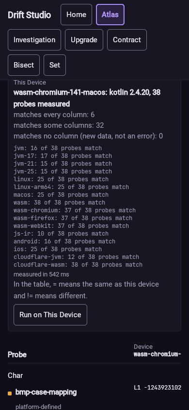

A difference between targets says nothing yet about a cause. Each probe row also carries a label
such as "documented" (the Kotlin documentation explains the difference), "platform-defined" or
"unclassified: no explanation found".

### Guess the Result

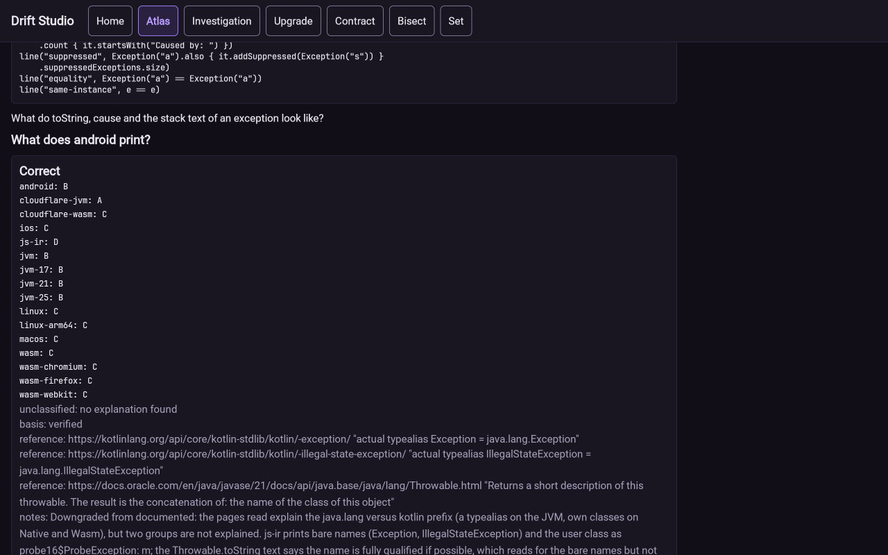

Choose **Guess the Result** next to **Compare Targets** to switch the screen to a quiz. Each question
shows a probe's source code and asks what it prints on one target, for example "What does android
print?" Pick one of the printed outputs, A to D, or **I Don't Know**. Studio then shows which
targets print each answer, whether you were right, and the reference behind the classification. The
score line at the top counts correct, wrong and skipped answers. **Next Probe** moves on.

## Case

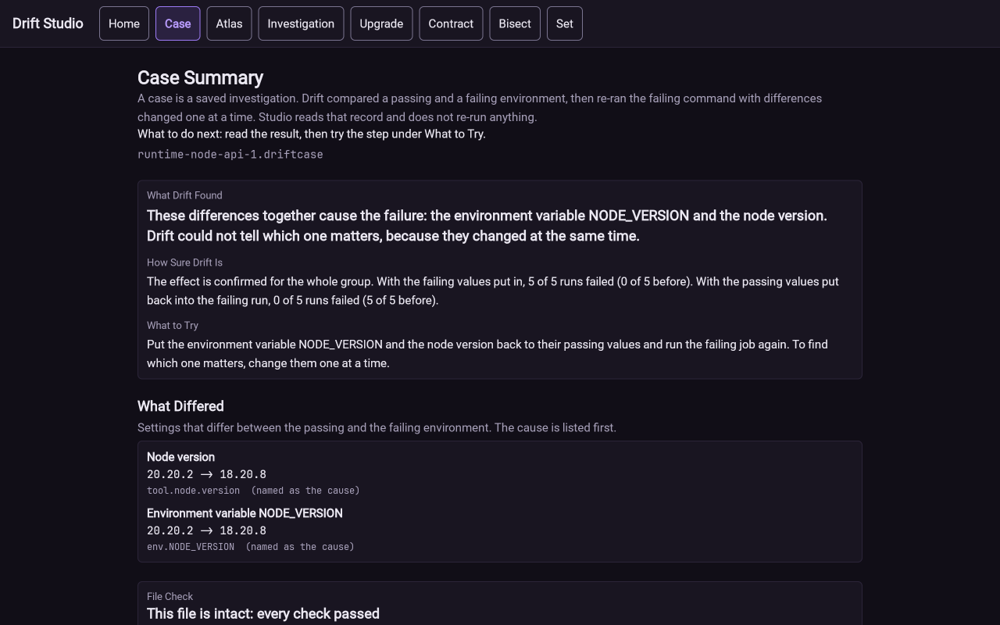

A case is a saved investigation: a `.driftcase` file written by `drift solve`. Drift compared a
passing and a failing environment, then re-ran the failing command with differences changed one at a
time. Studio reads that record and re-runs nothing.

To open one, choose **Choose a Case File** on Home and pick a file. The repository holds some in
[fixtures/lab/cases](./fixtures/lab/cases); the picture shows `runtime-node-api-1.driftcase`.

The Case Summary has these parts:

- **What Drift Found** is the verdict in one sentence. Here the node version and the environment
  variable `NODE_VERSION` together cause the failure, and Drift cannot say which of the two matters
  because they changed together.
- **How Sure Drift Is** gives the counts behind the verdict: with the failing values put in, 5 of 5
  runs failed, and with the passing values put back, 0 of 5 did.
- **What to Try** is the next step to take.
- **What Differed** lists the settings that changed, with the cause first.

### File Check

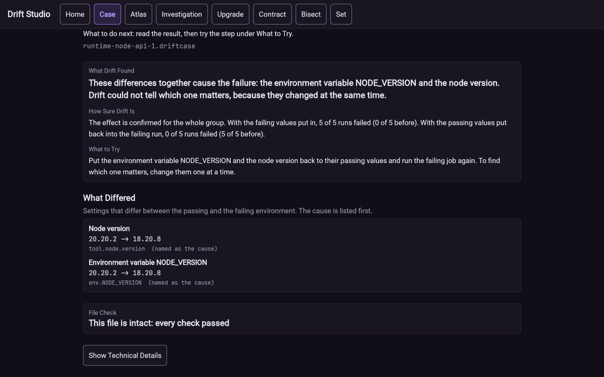

A certificate is the record of every run in a solve and its verdict, kept inside the `.driftcase`
file. Studio's name for the check of that record is **File Check**. It recomputes every count and
verdict from the file itself and does not run anything again. "This file is intact: every check
passed" means the numbers in the file agree with each other. A changed or cut-off file shows the check
that failed instead. **Show Technical Details** lists every check.

## Set

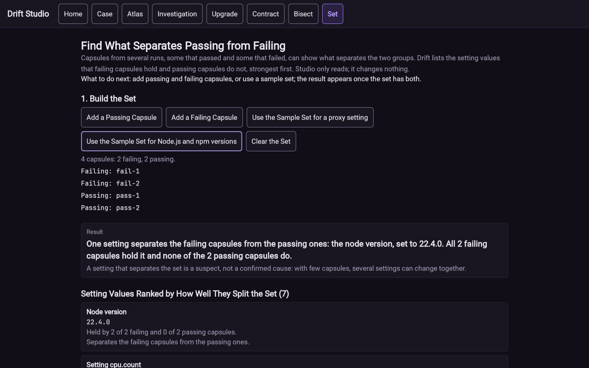

Choose **Set** at the top. The screen is titled "Find What Separates Passing from Failing". Given
capsules from several passing runs and several failing ones, it lists the setting values that the
failing capsules hold and the passing ones do not.

What to do:

1. Build the set. **Add a Passing Capsule** and **Add a Failing Capsule** open a file chooser. To
   try it without files, choose **Use the Sample Set for Node.js and npm versions**.
2. Read the Result box. In the picture, one setting separates the groups: the node version 22.4.0,
   held by both failing capsules and neither passing one.
3. Read the ranked list below it. Each entry says how many failing and passing capsules hold that
   value.
4. Choose **Clear the Set** to start again.

A setting that separates the set is a suspect, not a confirmed cause, because with few capsules several
settings can change together.

## Upgrade

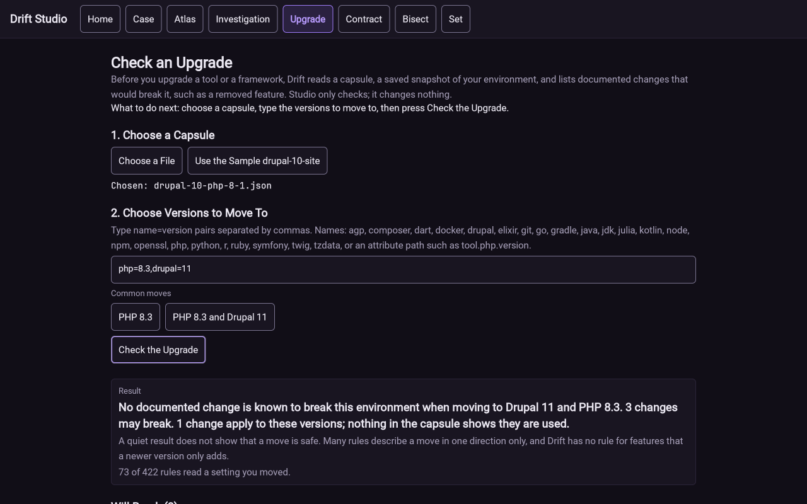

The Upgrade screen is titled "Check an Upgrade". It reads a capsule and lists documented changes that
would break that environment if you moved to the versions you type, such as a removed feature.

What to do:

1. Under **1. Choose a Capsule**, choose a file, or choose **Use the Sample drupal-10-site**.
2. Under **2. Choose Versions to Move To**, type `name=version` pairs separated by commas, such as
   `php=8.3,drupal=11`, or choose one of the **Common moves** buttons.
3. Choose **Check the Upgrade**.

The result says how many documented changes may break the environment and how many apply to the
versions you chose. The screen warns that a quiet result does not show a move is safe: many rules
describe a move in one direction only, and Drift has no rule for features that a newer version only
adds. A line such as "73 of 426 rules read a setting you moved" tells you how much of the rule set
looked at your change.

## Contract

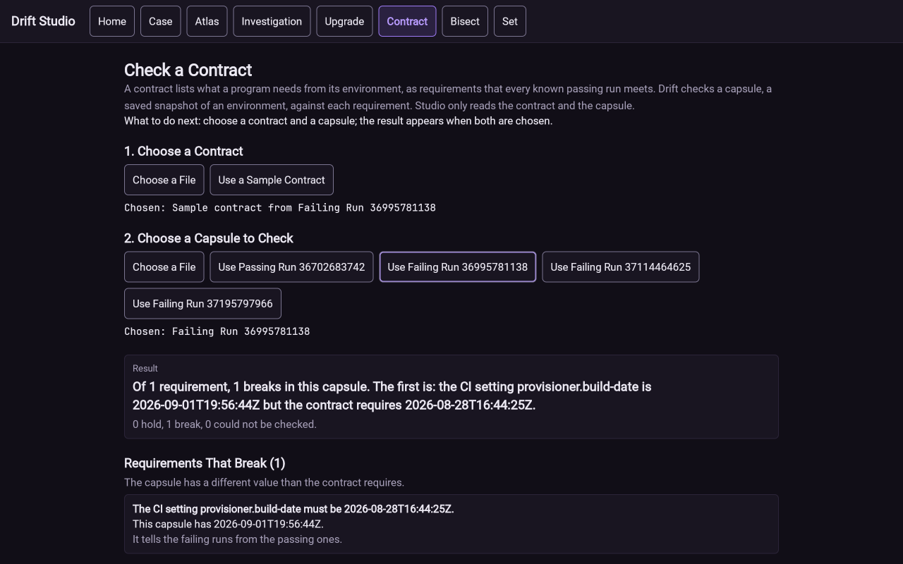

The Contract screen is titled "Check a Contract". A contract lists what a program needs from its
environment, as requirements that every known passing run meets. Drift checks a capsule against each
requirement.

What to do:

1. Under **1. Choose a Contract**, choose a file, or choose **Use a Sample Contract**.
2. Under **2. Choose a Capsule to Check**, choose a file, or choose one of the sample runs.
3. The result appears as soon as both are chosen.

The result counts requirements that hold, break, or could not be checked. In the picture the sample
contract has one requirement, the CI setting `provisioner.build-date`, and the failing run breaks
it. Each broken requirement shows what the contract requires and what the capsule has.

## Bisect

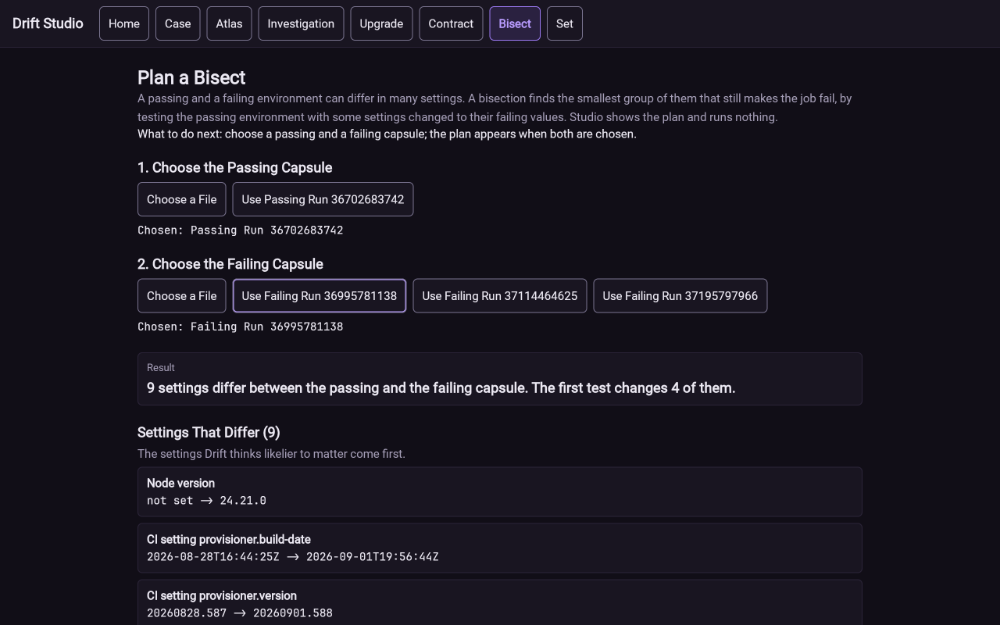

The Bisect screen is titled "Plan a Bisect". A passing and a failing environment can differ in many
settings. A bisection finds the smallest group of them that still makes the job fail, by testing
the passing environment with some settings changed to their failing values. Studio shows the plan and
runs nothing.

What to do:

1. Under **1. Choose the Passing Capsule**, choose a file or the sample passing run.
2. Under **2. Choose the Failing Capsule**, choose a file or one of the sample failing runs.
3. Read the plan. In the picture, 9 settings differ and the first test changes 4 of them.

Settings Drift thinks likelier to matter are listed first. To carry the plan out, use `drift bisect`
(see [Bisect](./ADVANCED_USAGE.md#bisect) in the usage guide).

## Retaking Screenshots

Every image comes from one Studio web build. After a Studio change, rebuild and retake the pictures
with these steps.

Build the bundle with `./gradlew :studio:wasmJsBrowserDistribution`. Serve
`studio/build/dist/wasmJs/productionExecutable` on loopback, for example with
`python3 -m http.server 8765 --bind 127.0.0.1` run in that directory, and open
`http://127.0.0.1:8765/`. Set the window to the viewport in the table with the device pixel ratio at 1,
so a 1280 by 800 window gives a 1280 by 800 file. Take viewport screenshots only. Use only the
sample data and the repository fixture below.

Studio draws on a canvas, so the page does not scroll with the normal wheel in some automation tools. The
rows marked "scrolled" need the page moved down by the stated number of wheel steps of 150 pixels.

| File | Viewport | Start | State and clicks |
| --- | --- | --- | --- |
| `home.png` | 1280 x 800 | `/` | Home, nothing clicked. |
| `home-phone.png` | 390 x 844 | `/` | Home on a mobile viewport, after a reload. |
| `investigation.png` | 1280 x 800 | `/` | **Show a Sample**, then select the first difference ("Node version"). |
| `atlas-device.png` | 1280 x 800 | `/` | **Atlas** tab. Wait for "measured in" to appear in the This Device panel. |
| `atlas-device-phone.png` | 390 x 844 | `/` | **Atlas** tab on a mobile viewport, then scrolled 4 steps so the This Device panel shows. |
| `atlas-guess.png` | 1280 x 800 | `/` | **Atlas** tab, **Guess the Result**, scrolled 8 steps, choose answer B, then scrolled up 30 and down 4 steps. |
| `case-summary.png` | 1280 x 800 | `/` | **Choose a Case File** with `fixtures/lab/cases/runtime-node-api-1.driftcase`. |
| `case-certificate.png` | 1280 x 800 | `/` | The same case, scrolled 5 steps so File Check shows. |
| `set.png` | 1280 x 800 | `/` | **Set** tab, **Use the Sample Set for Node.js and npm versions**. |
| `upgrade.png` | 1280 x 800 | `/` | **Upgrade** tab, **Use the Sample drupal-10-site**, **PHP 8.3 and Drupal 11**, **Check the Upgrade**. |
| `contract.png` | 1280 x 800 | `/` | **Contract** tab, **Use a Sample Contract**, **Use Failing Run 36995781138**. |
| `bisect.png` | 1280 x 800 | `/` | **Bisect** tab, **Use Passing Run 36702683742**, **Use Failing Run 36995781138**. |

Check each new image by eye for a user name, host name, absolute path or bookmark bar before keeping it.
Keep each file under about 400 KB.

## Claims to Check

Each sentence below states something this manual says that a later change to Studio could make false.

- Studio reads files and sends nothing anywhere (the Atlas footer says so on screen).
- The Home screen has boxes titled Open a Case, Try a Sample, Check an Upgrade, Check a Contract, Plan a Bisect, Compare a Set and Browse the Atlas.
- The top row has the buttons Home, Atlas, Investigation, Upgrade, Contract, Bisect and Set, and a Case button once a case is open.
- **Show a Sample** opens the Investigation screen with three failing runs compared with passing run 36702683742.
- The sample investigation says that 9 differences tie for the top place and that the first is the node version.
- The Atlas measures the device when Studio opens, and **Run on This Device** measures again.
- On Kotlin 2.4.20 the Atlas reports 32 of 38 probes differing between targets.
- **Guess the Result** shows a probe's source, four lettered answers and **I Don't Know**, and a score line.
- `fixtures/lab/cases/runtime-node-api-1.driftcase` opens as a case that names the node version and `NODE_VERSION` together as the cause, with 5 of 5 failing runs and 0 of 5 after the fix.
- File Check on that case reads "This file is intact: every check passed".
- The sample set for Node.js and npm versions has 4 capsules and one separating setting, the node version 22.4.0.
- Upgrade accepts `name=version` pairs and has a Common moves row with PHP 8.3 and PHP 8.3 and Drupal 11.
- With the sample drupal-10-site and `php=8.3,drupal=11`, the upgrade result reads "73 of 426 rules read a setting you moved".
- With the sample contract and Failing Run 36995781138, Contract reports 1 requirement and 1 break.
- With the two sample runs named above, Bisect reports 9 settings that differ and a first test that changes 4.
- The web build is served at <https://drift.gmitch215.dev/atlas/> and by `drift serve --dir cli/build/serve/studio` after `./gradlew :cli:stageStudio`.
