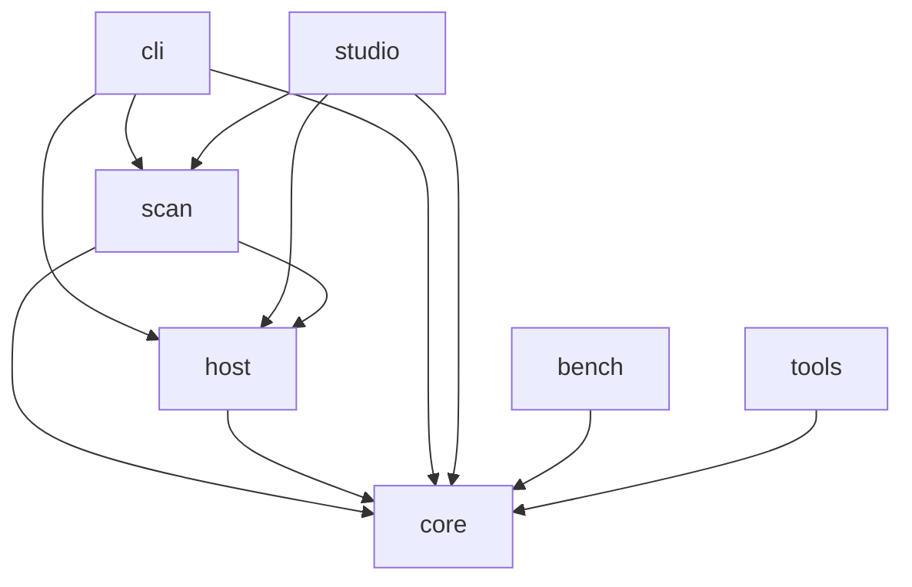
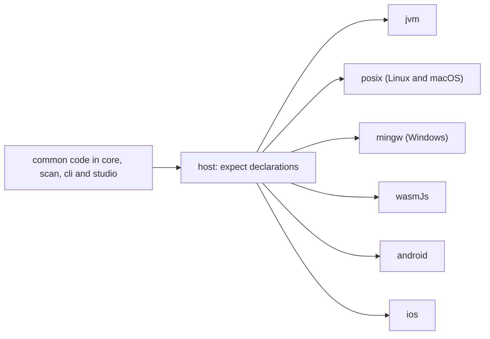
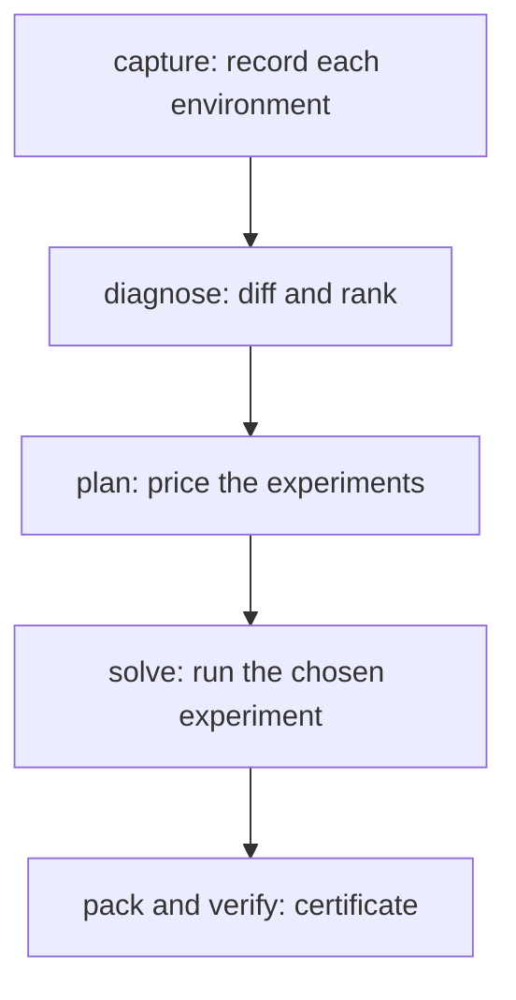

# Architecture

## Modules

| Module | Owns |
| --- | --- |
| `core` | Capsule model, canonical JSON, SHA-256, fixed-point math, diff, ranking, rules, planner, Lab. Common code only. |
| `host` | Operating system access, one implementation per target (JVM, Linux, macOS, Windows, Wasm, Android, iOS). |
| `scan` | Probes, toolchain scanners, the Atlas dataset builder and the probe classification. |
| `cli` | The `drift` command and its subcommands, including `upgrade-check`, `triage`, `contract`, `install`, `uninstall` and `serve`. |
| `studio` | The Compose Multiplatform app for desktop, web, Android and iOS: Home, Case, Atlas, Investigation, Upgrade, Contract and Bisect screens, and the installer packaging. |
| `bench` | DriftBench, a seeded benchmark of container pairs with an injected cause. |
| `tools` | Fixture freezing, Atlas ladder tooling, the triage corpus builder and scorer, the performance rig and the installer test scripts. |
| `androidApp`, `iosApp` | The Android and iOS app shells. They exist only under `-Pdrift.mobile=true`. |
| `packaging` | Homebrew formula and cask and Chocolatey package templates, rendered by `./gradlew renderPackaging` after a release. |
| `atlas` | Hand-written probe classification, column descriptions and repro drafts in YAML. The build embeds the classification and builds the static site from it. |
| `build-core` | Gradle convention plugins and build tasks: rules, Atlas site, packaging templates, Dokka. |
| `rules` | Hand-written rule files in YAML. The build generates the JSON that `core` reads. |
| `triage` | The manifest of the issue corpus that `drift triage` is measured on, and the claim-check labels. |
| `fixtures` | Recorded capsules, Atlas transcripts, solved cases, flagship cases, project trees, issue bodies and upgrade-check captures. |
| `install.sh`, `install.ps1` | Download, verify and install a release. |

## Dependencies

`host` depends on `core`, `scan` depends on `core` and `host`, and `cli` and `studio` depend on all
three. `bench` and `tools` depend on `core` alone. `androidApp` wraps `studio`.

## Platform Code

`core` and `scan` have no platform source sets. Every `expect` and `actual` pair lives in `host`,
which has one source set per target: JVM, Windows, Wasm, Android and iOS, plus a `posix` set that
Linux and macOS share. Common code in the other modules reaches the operating system only through
`host`.

## Investigation Chain

An investigation runs in five steps. `drift capture` records an environment as a capsule.
`drift diagnose` diffs a passing and a failing capsule and ranks the differences. The planner prices
each possible experiment and proposes one. `drift solve` runs it in containers under a decision rule
fixed before the first trial. `drift pack` writes the result as a `.driftcase` certificate, and
`drift verify` re-derives its counts and verdict from the file.

[Shared Code](shared-code.md) lists how much of this code is common to every target.
